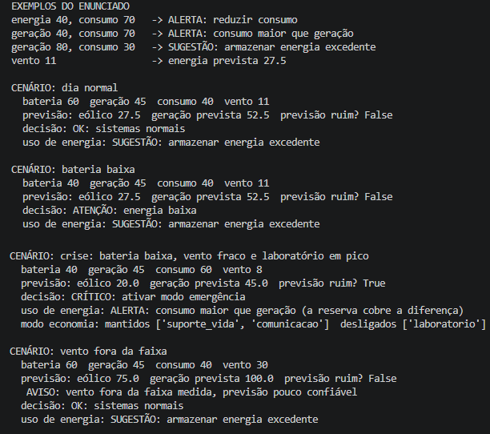

# Colônia Aurora Siger: sistema de energia inteligente

Projeto da Fase 3 da FIAP, "A Aurora Estabelece os Primeiros Sistemas da Colônia". Autor: Célio Carlos Pereira Junior.

O sistema organiza os dados da colônia em Marte, decide automaticamente o que fazer com a energia e usa o vento medido no passado para prever a geração eólica. Foi feito só com Python puro, sem bibliotecas externas.

## Como rodar

Precisa apenas do Python 3 instalado.

```
python projeto/codigos/main.py
```

## Como o sistema funciona

O programa lê os dados da colônia, prevê a energia eólica, decide a ação e mostra o resultado. Cada etapa fica em um arquivo:

- `projeto/codigos/dados.py`: guarda os dados. Dicionários dentro de dicionários formam a hierarquia (sistema energético com solar, eólico e baterias; sistema ambiental; módulos operacionais). Listas guardam o histórico de vento e de energia.  
- `projeto/codigos/decisoes.py`: as regras de decisão, escritas com `if`, `elif` e `else`, da situação mais grave para a menos grave.  
- `projeto/codigos/previsao.py`: a regressão linear simples feita à mão (método dos mínimos quadrados), que estima a energia eólica a partir do vento.  
- `projeto/codigos/main.py`: junta tudo. É o único arquivo que se executa.

### Regras de decisão

As regras são testadas de cima para baixo, e a primeira que for verdadeira vence. Os limites são estritos: bateria 50 não é baixa e consumo 50 não é alto.

- bateria menor que 50, consumo maior que 50 e previsão ruim: `CRÍTICO: ativar modo emergência`  
- bateria menor que 50 e consumo maior que 50: `ALERTA: reduzir consumo`  
- bateria menor que 50: `ATENÇÃO: energia baixa`  
- qualquer outro caso: `OK: sistemas normais`

A previsão é considerada ruim quando a geração prevista (solar mais eólica prevista) é menor que o consumo.

No modo emergência o suporte à vida e a comunicação continuam ligados, e os módulos não essenciais (o laboratório) são desligados.

### Análise do uso de energia

- consumo maior que geração: `ALERTA: consumo maior que geração`, com a informação se a reserva (bateria) cobre a diferença  
- geração maior que consumo: `SUGESTÃO: armazenar energia excedente`  
- iguais: `OK: geração e consumo equilibrados`

### Previsão

A reta `energia = b0 + b1 * vento` é ajustada com o histórico `vento = [8, 10, 12]` e `energia = [20, 25, 30]`, o que dá `b0 = 0` e `b1 = 2,5`. Para vento 11 a previsão é 27,5. Se o vento estiver fora da faixa medida (8 a 12), o sistema mostra um aviso, porque a reta pode errar muito fora dela.

## Exemplo de entrada e saída

```
energia 40, consumo 70   ->  ALERTA: reduzir consumo
geração 40, consumo 70   ->  ALERTA: consumo maior que geração
geração 80, consumo 30   ->  SUGESTÃO: armazenar energia excedente
vento 11                 ->  energia prevista 27.5
```

Execução completa:



## Limites conhecidos

- A reta usa só 3 pontos medidos, então o R² igual a 1 não prova que o modelo é bom.  
- A potência eólica real cresce com o cubo do vento. A reta é uma aproximação válida só dentro da faixa medida.  
- "Previsão ruim" é uma definição simples do projeto: geração prevista menor que o consumo.  
- As temperaturas estão guardadas nos dados, mas ainda não entram nas regras de decisão.